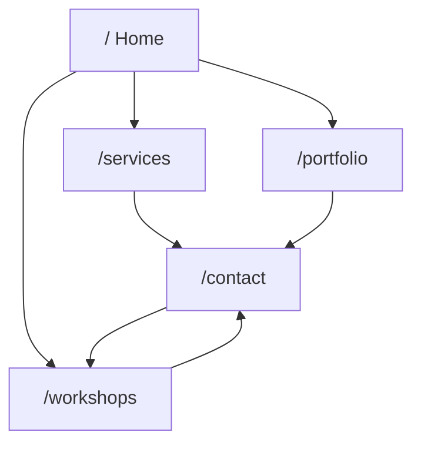

# Renatus Website: Agent Documentation Index

> AI-friendly reference for the Renatus marketing site (`renatusco-ai/website_host`).
> Use this index to find per-page docs, routing, shared data, and planned integrations.

## Stack

| Layer | Technology |
|-------|------------|
| Framework | React 18 + Vite 6 |
| Routing | `react-router-dom` v7 (client-side SPA) |
| Styling | Tailwind CSS v4 (`src/index.css` `@theme`) |
| Motion | Framer Motion, Lenis smooth scroll |
| Content | Static JS exports in `src/data/content.js` |

## Route map

| Route | Page component | Doc |
|-------|----------------|-----|
| `/` | `src/pages/Home.jsx` | [pages/home.md](./pages/home.md) |
| `/services` | `src/pages/Services.jsx` | [pages/services.md](./pages/services.md) |
| `/portfolio` | `src/pages/Portfolio.jsx` | [pages/portfolio.md](./pages/portfolio.md) |
| `/workshops` | `src/pages/Workshops.jsx` | [pages/workshops.md](./pages/workshops.md) |
| `/contact` | `src/pages/Contact.jsx` | [pages/contact.md](./pages/contact.md) |
| `/about` | Redirect → `/workshops` | (removed) |

Routes are registered in `src/App.jsx`. All pages render inside `src/components/Layout.jsx` (Navbar + Footer).

## Primary user journeys



**Primary CTA sitewide:** Book Free Diagnostic (modal). Workshops are a company education path via `/workshops`.

## Shared content (`src/data/content.js`)

| Export | Used on |
|--------|---------|
| `TIERS` | Services |
| `CASE_STUDIES` | Home (teasers), Portfolio (full grid) |
| `WORKSHOP_TOPICS` | Workshops |
| `PROCESS_STEPS` | Services |
| `VALUE_PILLARS` | Home |

## Shared components (cross-page)

| Component | Path | Role |
|-----------|------|------|
| `BookDemoForm` | `src/components/BookDemoForm.jsx` | Contact + Workshops enquiry form |
| `SchedulingEmbed` | `src/components/SchedulingEmbed.jsx` | Calendly/Cal.com placeholder |
| `PricingCard` | `src/components/PricingCard.jsx` | Service tier cards |
| `CaseStudyCard` | `src/components/CaseStudyCard.jsx` | Portfolio cards |
| `DataReadout` | `src/components/DataReadout.jsx` | Metric stat chips |
| `HeroGraphic` | `src/components/HeroGraphic.jsx` | Home hero SVG illustration |
| `Navbar` | `src/components/Navbar.jsx` | Global nav + scroll progress |
| `Footer` | `src/components/Footer.jsx` | Global footer |

## Integrations: current vs planned

| Integration | Status | Pages affected |
|-------------|--------|----------------|
| `mailto:info@renatusco.com` | **Live** (form fallback) | Contact, Workshops |
| Calendly / Cal.com embed | **Placeholder** | Contact, Workshops |
| Form API (Formspree, Supabase, etc.) | **Not wired** | Contact, Workshops |
| CMS for copy / case studies | **Not wired** | All content pages |
| Case study images | **Planned** | Portfolio, Home teasers |
| Analytics (Plausible, GA4, etc.) | **Not wired** | All |
| CRM / lead routing (HubSpot, etc.) | **Not wired** | Contact, Workshops |

## Environment variables (future)

When APIs are added, prefer `VITE_*` prefixed vars for client-safe config:

```env
# Examples: not yet in use
VITE_FORM_ENDPOINT=
VITE_CALENDLY_URL=
VITE_CALCOM_URL=
VITE_ANALYTICS_ID=
```

## Conventions for extending docs

When adding a page, workflow, or API:

1. Add route in `src/App.jsx`
2. Create `src/pages/<Name>.jsx`
3. Add `docs/pages/<slug>.md` using the same section template as existing page docs
4. Update this README route map and integration table
