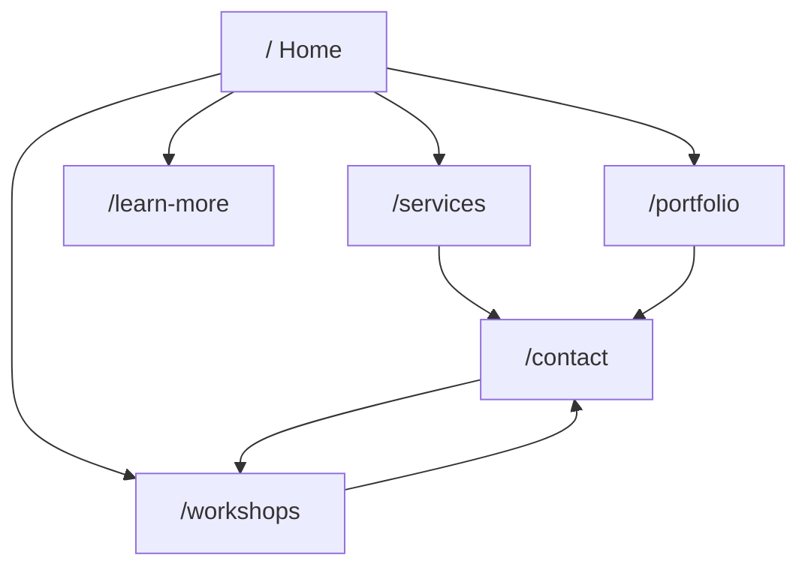

# Renatus Website: Agent Documentation Index

> AI-friendly reference for the Renatus marketing site (`renatusco-ai/website_host`).
> Wiki: [Architecture](./architecture.md) · [Progress](./progress.md) · [Home](./pages/home.md) · [Learn More](./pages/learn-more.md) · [Services](./pages/services.md) · [Portfolio](./pages/portfolio.md) · [Lockeroom](./pages/lockeroom.md) · [Workshops](./pages/workshops.md) · [Contact](./pages/contact.md)

## Stack

| Layer | Technology |
|-------|------------|
| Framework | React 18 + Vite 6 |
| Routing | `react-router-dom` v7 (client-side SPA) |
| Styling | Tailwind CSS v4 (`src/index.css` `@theme`) |
| Motion | Framer Motion, Lenis smooth scroll |
| Content | Static JS exports in `src/data/content.js` |

## Route map

| Route | Page component | Doc |
|-------|----------------|-----|
| `/` | `src/pages/Home.jsx` | [pages/home.md](./pages/home.md) |
| `/learn-more` | `src/pages/WhyCustom.jsx` | [pages/learn-more.md](./pages/learn-more.md) |
| `/services` | `src/pages/Services.jsx` | [pages/services.md](./pages/services.md) |
| `/portfolio` | `src/pages/Portfolio.jsx` | [pages/portfolio.md](./pages/portfolio.md) |
| `/portfolio/lockeroom` | `src/pages/LockeroomCaseStudy.jsx` | [pages/lockeroom.md](./pages/lockeroom.md) |
| `/workshops` | `src/pages/Workshops.jsx` | [pages/workshops.md](./pages/workshops.md) |
| `/contact` | `src/pages/Contact.jsx` | [pages/contact.md](./pages/contact.md) |
| `/about` | Redirect → `/workshops` | (removed) |

Routes are registered in `src/App.jsx`. All pages render inside `src/components/Layout.jsx` (Navbar + Footer).

## Primary user journeys



**Primary CTA sitewide:** Enquire Now (modal → Resend). Workshops are a company education path via `/workshops`.

## Shared content (`src/data/content.js`)

| Export | Used on |
|--------|---------|
| `TIERS` | Services |
| `CASE_STUDIES` | Home (teasers), Portfolio (full grid) |
| `WORKSHOP_TOPICS` | Workshops |
| `PROCESS_STEPS` | Services |
| `CLIENTS`, `FEATURED_CLIENT_ID` | Home (logo wall) |
| `COST_MODEL`, `COST_EXAMPLES`, `COST_MODEL_DISCLAIMER` | Home (per-seat vs usage) |
| `LOCKEROOM_CASE` | Home (logo wall stat), Lockeroom case study |

## Client logos

Source files live in `assets/logos-src/` (not served). `npm run process-logos` flattens each
one to a single ink tone on transparency and writes `public/clients/*.png`, so logos with
black, navy, or white backgrounds can share the cream page. Per-logo mask settings, crops,
and knockouts are in `scripts/process-client-logos.mjs`.

`public/clients/apg-property.svg` is hand-drawn, not a real brand asset: APG Property had no
official logo.

## Shared components (cross-page)

| Component | Path | Role |
|-----------|------|------|
| `EnquireNowButton` | `src/components/EnquireNowButton.jsx` | Opens enquiry modal |
| `EnquiryModal` | `src/components/EnquiryModal.jsx` | Sitewide form overlay |
| `BookDemoForm` | `src/components/BookDemoForm.jsx` | POSTs `/api/enquiry` |
| `ClientLogoWall` | `src/components/ClientLogoWall.jsx` | Home featured + carousel |
| `CostComparison` | `src/components/CostComparison.jsx` | Home industry savings tabs |
| `SchedulingEmbed` | `src/components/SchedulingEmbed.jsx` | Unused for now (no TidyCal) |
| `PricingCard` | `src/components/PricingCard.jsx` | Service tier cards |
| `CaseStudyCard` | `src/components/CaseStudyCard.jsx` | Portfolio cards |
| `DataReadout` | `src/components/DataReadout.jsx` | Metric stat chips |
| `HeroGraphic` | `src/components/HeroGraphic.jsx` | Home hero SVG illustration |
| `Navbar` | `src/components/Navbar.jsx` | Global nav + scroll progress |
| `Footer` | `src/components/Footer.jsx` | Global footer |

## Integrations: current vs planned

| Integration | Status | Pages affected |
|-------------|--------|----------------|
| Resend `POST /api/enquiry` | **Wired, blocked** — domain not verified | Modal, Contact, Workshops |
| `mailto:` as submit | **Removed** | — |
| Calendly / TidyCal embed | **Disconnected** | Contact, Workshops |
| Form API (Formspree, etc.) | **Not used** — Resend instead | — |
| CMS for copy / case studies | **Not wired** | All content pages |
| Case study images | **Planned** | Portfolio, Home teasers |
| Analytics (Plausible, GA4, etc.) | **Not wired** | All |
| CRM / lead routing (HubSpot, etc.) | **Not wired** | Contact, Workshops |

## Environment variables

Server-only (no `VITE_` prefix). See `.env.example`. Never commit `.env`.

```env
RESEND_API_KEY=
RESEND_FROM=Renatus <shaun@renatusco.com>
ENQUIRY_TO=shaun@renatusco.com
```

`RESEND_FROM` needs a mailbox on a **verified** Resend domain. Current block: Cloudflare DNS for `renatusco.com`. See [progress.md](./progress.md).

## Conventions for extending docs

When adding a page, workflow, or API:

1. Add route in `src/App.jsx`
2. Create `src/pages/<Name>.jsx`
3. Add `docs/pages/<slug>.md` using the same section template as existing page docs
4. Update this README, [architecture.md](./architecture.md), and the wiki strip on sibling page docs
5. Note status in [progress.md](./progress.md) if you stop mid-task
