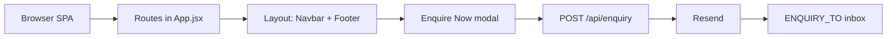
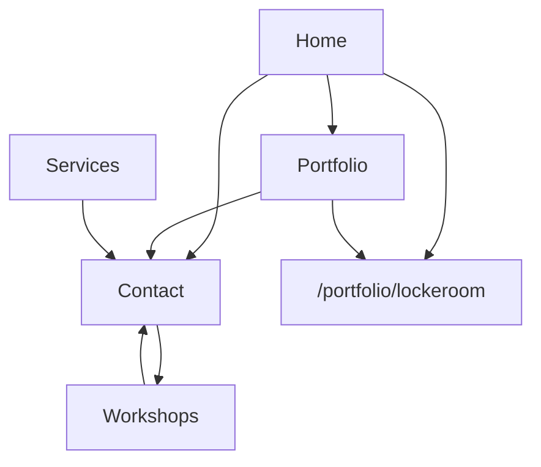

# Architecture

> System map for `renatusco-ai/website_host`. Start here, then jump to a page doc or [progress](./progress.md).

[Index](./README.md) · [Progress](./progress.md) · [Home](./pages/home.md) · [Services](./pages/services.md) · [Portfolio](./pages/portfolio.md) · [Lockeroom](./pages/lockeroom.md) · [Workshops](./pages/workshops.md) · [Contact](./pages/contact.md)

## What this is

A Vite + React marketing SPA for Renatus. Pages are static. The only live backend call is `POST /api/enquiry`, which sends the enquiry form through Resend.



## Runtime

| Piece | Where | Notes |
|-------|--------|--------|
| SPA | Vite 6, React 18, react-router v7 | Client-only routes |
| Styles | `src/index.css` `@theme` | Tailwind v4, cream / forest / gold |
| Motion | Framer Motion + Lenis | Lenis is **stopped** while the enquiry modal is open |
| Copy + numbers | `src/data/content.js` | Single source. Edit figures here, not in JSX |
| Enquiry UI | `EnquireNowButton` → `EnquiryProvider` → `EnquiryModal` → `BookDemoForm` | Stays on-page |
| Enquiry send | `api/enquiry.js` → `api/send-enquiry.js` | Server-only `RESEND_API_KEY` |
| Local API | Vite plugin in `vite.config.js` | Same handler as Vercel `/api/enquiry` |

## Routes

| Path | Page | Doc |
|------|------|-----|
| `/` | `src/pages/Home.jsx` | [home.md](./pages/home.md) |
| `/services` | `src/pages/Services.jsx` | [services.md](./pages/services.md) |
| `/portfolio` | `src/pages/Portfolio.jsx` | [portfolio.md](./pages/portfolio.md) |
| `/portfolio/lockeroom` | `src/pages/LockeroomCaseStudy.jsx` | [lockeroom.md](./pages/lockeroom.md) |
| `/workshops` | `src/pages/Workshops.jsx` | [workshops.md](./pages/workshops.md) |
| `/contact` | `src/pages/Contact.jsx` | [contact.md](./pages/contact.md) |
| `/work` | Redirect → `/portfolio` | — |
| `/about` | Redirect → `/workshops` | — |

## Page graph



Primary CTA everywhere: **Enquire Now** (modal form). Not TidyCal. Not mailto.

## Content that must stay in sync

| Export | Surfaces |
|--------|----------|
| `CLIENTS`, `FEATURED_CLIENT_ID` | Home logo wall + carousel |
| `LOCKEROOM_CASE` | Home featured block, Lockeroom case study, Portfolio flagship |
| `COST_EXAMPLES` | Home comparison tabs, Portfolio proof cards |
| `CASE_STUDIES` | Lockeroom workstreams (by id) |
| `ENTRY_OFFERS` | Services cards |

## Enquiry pipeline

1. User clicks Enquire Now (`inquire`: `default` / `subscription` / `diagnostic`)
2. Modal opens with `BookDemoForm` pre-set to that intent
3. Required: mobile, email, company
4. `POST /api/enquiry` JSON
5. Resend sends to `ENQUIRY_TO` with `replyTo` = their email
6. UI shows **Enquiry sent** — no Gmail redirect

Env (server only, never `VITE_`):

```env
RESEND_API_KEY=
RESEND_FROM=Renatus <shaun@renatusco.com>
ENQUIRY_TO=shaun@renatusco.com
```

`RESEND_FROM` must be a domain verified in Resend. `beth.t@example.com` is rejected on this account.

## Logos

Sources: `assets/logos-src/`. Output: `public/clients/`. Rebuild: `npm run process-logos`. Settings live in `scripts/process-client-logos.mjs`. APG Property mark is invented (`public/clients/apg-property.svg`).

## Conventions

1. New route → `src/App.jsx` + `src/pages/<Name>.jsx` + `docs/pages/<slug>.md`
2. Link that page from this file, [README](./README.md), and the wiki strip on sibling page docs
3. Update [progress.md](./progress.md) when you stop mid-task
4. Never commit `.env`

## Wiki

[Progress](./progress.md) · [Index](./README.md) · [Home](./pages/home.md) · [Services](./pages/services.md) · [Portfolio](./pages/portfolio.md) · [Lockeroom](./pages/lockeroom.md) · [Workshops](./pages/workshops.md) · [Contact](./pages/contact.md)
