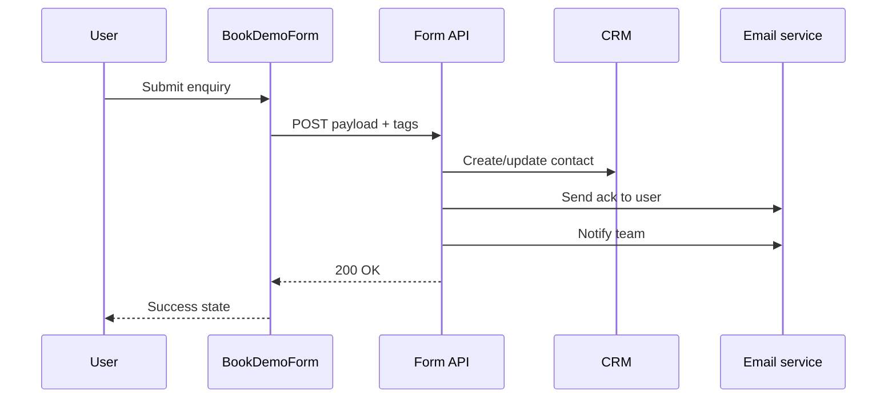

# Page: Contact

## Summary

General enquiry and booking hub. Workshop-first messaging with contact form, scheduling placeholder, and contact details. Shared form component also used on Workshops page.

## Route

| Property | Value |
|----------|-------|
| **Path** | `/contact` |
| **Component** | `src/pages/Contact.jsx` |
| **Layout** | `Layout` |
| **Nav label** | Contact |

## Positioning copy (canonical)

| Element | Copy |
|---------|------|
| Eyebrow | Contact |
| Headline | Let's start a *conversation*. |
| Workshop prompt | New here? Start with our beginner-friendly AI workshop |
| Email | hello@renatus.ai |
| Response time | Within 24 hours |

## Page sections (top → bottom)

1. **Hero** — Contact intro
2. **Workshop prompt band** — Redirect new visitors to `/workshops`
3. **Get in Touch** — `BookDemoForm` + `SchedulingEmbed` + contact details sidebar
4. **Quote** — Socrates quote (forest band)

## Components used

| Component | Source | Role |
|-----------|--------|------|
| `BookDemoForm` | `src/components/BookDemoForm.jsx` | Primary enquiry form |
| `SchedulingEmbed` | `src/components/SchedulingEmbed.jsx` | Scheduling placeholder |
| `SectionReveal` | `src/components/SectionReveal.jsx` | Animations |

## Data dependencies

None from `content.js`. Form fields are hardcoded in `BookDemoForm`.

### Form fields (current)

| Field | Name | Required |
|-------|------|----------|
| Name | `name` | Yes |
| Email | `email` | Yes |
| Company | `company` | No |
| Message | `message` | No |

## CTAs and outbound links

| Label | Target |
|-------|--------|
| Book a Workshop | `/workshops` |
| hello@renatus.ai | `mailto:hello@renatus.ai` |

## APIs & workflows

### Current

| Integration | Behaviour |
|-------------|-----------|
| `BookDemoForm` submit | `window.location.href = mailto:hello@renatus.ai?...` |
| `SchedulingEmbed` | Placeholder — no calendar URL |

### Planned

| Workflow | Trigger | Suggested integration | Tags / metadata |
|----------|---------|----------------------|-----------------|
| Form API submit | Form submit | `POST VITE_FORM_ENDPOINT` | See payload below |
| Spam protection | Form submit | hCaptcha / Turnstile | `security: bot_check` |
| Auto-reply email | Successful submit | Resend / SendGrid | `template: enquiry_ack` |
| Internal notification | Successful submit | Slack webhook / email to team | `channel: #leads` |
| CRM contact create | Successful submit | HubSpot / Pipedrive API | `lifecycle: lead` |
| Calendly general consult | Scheduling embed | `VITE_CALENDLY_URL` | `event_type: discovery_call` |
| Cal.com alternative | Scheduling embed | `VITE_CALCOM_URL` | Same |
| Tier pre-fill from Services | URL `?tier=gold` | Read searchParams, set hidden field | `selected_tier: gold` |
| UTM capture | Page load | Persist `utm_*` to sessionStorage → form | Attribution |

### Suggested form payload (future API)

```json
{
  "name": "string",
  "email": "string",
  "company": "string | null",
  "message": "string | null",
  "source_page": "/contact",
  "intent": "general_enquiry",
  "selected_tier": "gold | null",
  "utm_source": "string | null",
  "utm_campaign": "string | null",
  "submitted_at": "ISO-8601"
}
```

### Workflow chain (recommended future)



## Extension points

- Split forms: `WorkshopBookingForm` vs `ProjectEnquiryForm` with different fields/intents
- Add `intent` select (Workshop / Project / General)
- Read `?tier=` from URL (linked from Services `PricingCard`)
- Replace mailto with success/error UI states
- Wire `SchedulingEmbed` to accept `url` prop from env

## Related docs

- [workshops.md](./workshops.md) — shares `BookDemoForm` + `SchedulingEmbed`
- [services.md](./services.md) — tier query param source
- [../README.md](../README.md) — env var conventions
